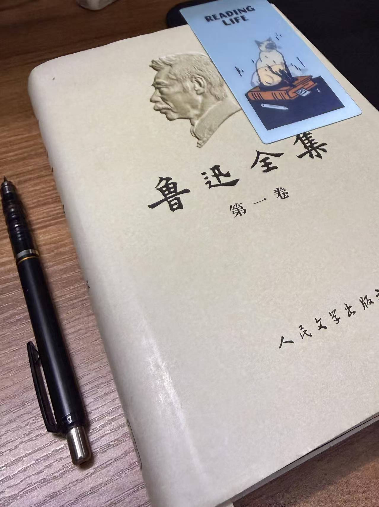

## 一直「拖延症」到如今才读完

前不久才终于把《鲁迅全集》的第一本啃下来；

说起来也是惭愧，似乎是一年前就开始看，但断断续续的，

而且并不是内容多到只能断断续续地看，而是一直卡在《呐喊》中的一篇文章——《摩罗诗力说》

卡了大概快半年时间，最开始是看到第三章后搁置了，

后续想重拾起来看时候，又要从头开始翻着看。

在这期间，因为早期文字还是保留文言文的使用习惯，又是大概是论述的性质，

所以既对照着译文看原文，又是边看边翻着古汉语词典来理解，

直到把这一篇啃完后，后面的内容，加上《热风》、《坟》也才恢复兴致，正常速度地看完。

## 为何要硬入手大部头还啃得这么辛苦

说实在话，对鲁迅的印象，似乎很多人是高考之后，了解了社会的方方面面，才开始意识到鲁迅文学的精彩之处；

对我而言便是如此，在此之前对鲁迅只是标签化的形象，加上名言的背诵，

直到后来大学选修课，印象挺深的；

没记错的话是大三时期，有一门是《野草》的鉴赏，

一方面可能也是其他教育类课程的不感兴趣，

另一方面好像也感觉「鲁迅」这一名字有种说不上来的好感，便在教务处网站上点选了确认。

那要修这门课程，总得去拜读这部作品吧。

于是跑去图书馆借阅了这部作品，最开始以为是很厚的一部作品，

毕竟作为文科生比较头大的一个名字，自然有一种「望而生畏」的敬畏感。

但拿到手，意外的是只是薄薄的一本。

记得大概花了一周时间，无聊时候就翻一翻，越看越有一种「我的嘴替」的熟悉感。

并非自卖自夸，但作为读文科的，脑子里总是偶尔飘出一些胡思乱想的想法，

对社会的，对自我存在的，对他人动机……

再加上之前从大三开始，对社会议题的反转再反转的失望，让我想在社科类书籍中寻求答案。

而《野草》留给我的印象，恰恰是一种类似虚无主义基调下的自我剖析和对周围的质问。

而这和我在往前的事件中胡思乱想的基调又有着一些共鸣之处，

所以记得这门课是晚课，而我又难得主动的早些到教室，并且主动地坐在前排，

只为了一方面能更好看清PPT，以及听清老师的分析和发言，

而且在那门课上，自己也是少有的会针对于老师提出的讨论话题，主动举手发言的时间，

不是为了回答对，而是想把自己的理解和比我知识水平高很多的老师相互印证。

而这般的交流和体验是读这一「师范」方向课程里，难得是快乐的学习体验。

## 接下来往后的体验

当然大学之后的社畜生活，让我也逐渐减少了拿起书看的频率，

直到稳定的生活节奏落实下来，才寻思着提升自己的知识武装水平，

恰巧又是关注的出版社直播推了，逛到了，寻思着既然对鲁迅有好感，那不如真真正正拜读他的作品。

当然人民文学出版社的全集价格贵是真的贵。

其实说得不严谨的，挺像现在的人根据社会中的是褒贬时评，

吸引我的不单单是很直白的、又话里藏针的讽刺，

更多的还有看到一些意向，直觉上会肯定其意有所指，等到查阅资料后，结合历史知识才明白实质时，

那种「哦~~原来是这样」的恍然大悟的欣喜。

当然在现在我又看其他书籍，毕竟换个口味脱离下节奏是我所习惯的，

但总而言之，还是希望自己能在未来的时间，能尽可能的有着主观能动性，来让自己博览吧。:)

